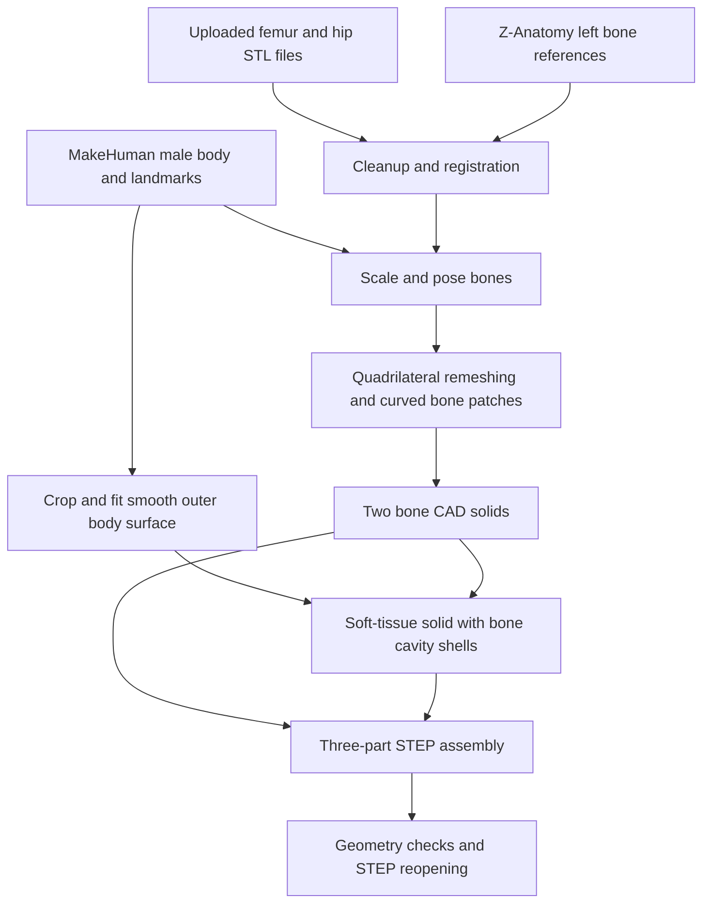

# Methodology: generic adult male left hip, buttock and thigh CAD assembly

## 1. Model identity and scope

This document describes the **smooth CAD revision** supplied in [NX_SMOOTH_CAD.zip](https://raw.githubusercontent.com/MartinSalehi/git_test/codex/left-male-hip-thigh/design-downloads/NX_SMOOTH_CAD.zip). The geometry was published in repository revision [`f0e0df1`](https://github.com/MartinSalehi/git_test/commit/f0e0df1864328c956db4f07b40eb14821439c6de).

The model represents a generic adult male's **left hip-to-knee region, including the left buttock**. It contains three separate solid bodies and two material groups:

| CAD component | Anatomical extent | Material group |
| --- | --- | --- |
| `FEMUR_L` | Complete femur, including head, neck, shaft and distal condyles | Bone |
| `HIP_L` | Left hip bone: ilium, ischium and pubis, retaining the obturator opening | Bone |
| `SOFT_TISSUE_L` | Cropped external body envelope, filled except for matching bone cavities | Combined muscle, fat and skin |

The soft-tissue part is a **homogeneous geometric volume**. Individual muscles, fat compartments and skin thickness were not segmented. The bones are solid volumes without separate cortical, trabecular or marrow regions. A separate patella, tibia, ligaments and articular cartilage are not included.

The external shape uses an adult male template. The uploaded bone files had no independently verified subject age, sex, imaging acquisition or anatomical calibration. The assembly is a synthetic combination of sources, rather than an imaging reconstruction of one individual.

## 2. Where the model was designed

The geometry was constructed programmatically in a cloud workspace using **Python, Blender, CadQuery and OpenCascade**. Blender was used for extracting reference meshes, quadrilateral remeshing and rendering. Python and the CAD kernel performed registration, surface construction, solid construction and export.

**NX 2406 is the target application.** The parts were not authored as native NX features. The deliverables are STEP AP214 solid bodies with assembly structure, component names and colours. Native NX `.prt` files can be created by opening and saving the imported parts in NX. No NX or ANSYS installation was available in the generation environment.

### Working locations

These are locations in the original cloud workspace, not paths expected to exist on the recipient's computer.

| Location | Purpose |
| --- | --- |
| `/workspace/attachments/` | Original user-uploaded STL files |
| `/workspace/male_left_thigh/sources/` | Downloaded source assets, atlas exports and registration records |
| `/workspace/male_left_thigh/output/` | Aligned dense bones, smooth outer tissue envelope and the initial dense CAD assembly |
| `/workspace/male_left_thigh/nx_fast/` | Final curved bone construction, regenerated tissue cavities and smooth STEP files |
| `/workspace/git_test/design-downloads/` | Published downloads, this methodology and supporting evidence |

## 3. Sources and their exact roles

| Source | What was used | Role in the final assembly |
| --- | --- | --- |
| User upload: `FEMUR_matched.stl` | Detailed femur surface | Primary source of femoral geometry |
| User upload: `HIP_matched.stl` | Main connected hip-bone surface | Primary source of hip-bone geometry |
| MakeHuman Community | `base.obj`, an adult male target and selected body-shape targets | External male body contour and hip/knee helper landmarks |
| Z-Anatomy / BodyParts3D | Blender objects `Femur.l` and `Hip bone.l` | Left-side anatomical registration references |
| Earlier bone-processing metadata from this conversation | Fitted femoral-head and acetabular centres | Reused landmarks for aligning the uploaded bones at the joint |

The earlier plaster positive and shortened-femur design were not used to generate this natural body envelope. The final femur is full length. Atlas muscle objects were available during source inspection, but individual atlas muscle meshes were not incorporated into the combined soft-tissue body.

### MakeHuman assets

- Repository: <https://github.com/makehumancommunity/makehuman>
- Source snapshot: [`a8bc2d54ff0ac92e78ff71431b1023eda42bf482`](https://github.com/makehumancommunity/makehuman/tree/a8bc2d54ff0ac92e78ff71431b1023eda42bf482)
- Base surface: [`makehuman/data/3dobjs/base.obj`](https://github.com/makehumancommunity/makehuman/blob/a8bc2d54ff0ac92e78ff71431b1023eda42bf482/makehuman/data/3dobjs/base.obj)
- Adult male target asset: `makehuman/data/targets/macrodetails/caucasian-male-young.target`. This is the source asset's filename; it is not a demographic determination about the user or the uploaded bones.

The following additional target weights were applied to the male body:

| Target asset | Weight |
| --- | ---: |
| `hip/hip-scale-horiz-incr.target` | 0.65 |
| `hip/hip-scale-depth-incr.target` | 0.65 |
| `buttocks/buttocks-volume-incr.target` | 0.25 |
| `macrodetails/universal-male-young-averagemuscle-maxweight.target` | 0.12 |

These are **unitless morph weights**, not percentages of body fat, measured dimensions or a specified body mass. They were selected to produce a usable generic male assembly with the bones enclosed. The complete body template was approximately **1,748.13 mm tall** before cropping. No target weight in kilograms was calibrated, and no population-average or 50th-percentile anthropometric fit was established.

### Z-Anatomy / BodyParts3D reference

- Repository: <https://github.com/Z-Anatomy/Models-of-human-anatomy>
- Source snapshot: [`d71cd657a0fd9fc774261ba403bc0a1e8eccd176`](https://github.com/Z-Anatomy/Models-of-human-anatomy/tree/d71cd657a0fd9fc774261ba403bc0a1e8eccd176)
- Asset: `Z-Anatomy.zip`, containing `Z-Anatomy/Startup.blend`.
- Reference bones were exported from the Blender library with their object transforms and converted to millimetres.
- Underlying anatomical database credited by Z-Anatomy: [BodyParts3D, The Database Center for Life Science](https://dbarchive.biosciencedbc.jp/en/bodyparts3d/download.html). The data used here were accessed through Z-Anatomy, rather than a separate direct BodyParts3D download.

## 4. Construction workflow

### 4.1 Bone cleanup and registration

The main connected bone component was retained from each uploaded STL, removing disconnected debris. STL files do not encode units; their dimensions were treated as nominal millimetres for this generic construction. No physical calibration measurement was supplied.

Each detailed bone was registered to its corresponding left-side atlas reference:

1. Sample 15,000 surface points for principal-component analysis, using random seed 17.
2. Generate eight principal-axis sign combinations as possible initial alignments.
3. Refine each candidate with VTK iterative closest point registration, allowing rotation, translation and uniform scale. The settings allowed up to 60 iterations and 3,000 landmarks.
4. Rank candidates using the 75th percentile of sampled distances to the atlas surface.

The selected source-to-atlas scale factors were approximately **0.93979 for the femur** and **0.92769 for the hip bone**. Their recorded registration distances were:

| Detailed bone versus atlas reference | Median sampled distance | 95th percentile |
| --- | ---: | ---: |
| Femur | 1.216 mm | 3.475 mm |
| Hip bone | 2.262 mm | 6.636 mm |

These values describe agreement between **different source anatomies**. They are not smoothing errors or measurements of agreement with a patient's anatomy. Complete selected transforms are in [detailed_registration.json](methodology_evidence/detailed_registration.json).

### 4.2 Placement inside the male body

The atlas femoral head was fitted approximately as a sphere. A distal condylar-region bounding-box heuristic supplied a knee reference. The reference skeleton was aligned and uniformly scaled to the MakeHuman hip and knee helper landmarks.

| Parameter | Value |
| --- | --- |
| Hip helper centre, mm | `(109.765, 3.830, 933.315)` |
| Knee helper centre, mm | `(152.528, -30.750, 507.218)` |
| Atlas-to-body scale | 1.055316 |
| Additional hip rotation | 17° anterior rotation about the hip centre |
| Additional hip scale | 1.006 about the hip centre |

The detailed femoral-head and acetabular centres were aligned to the common joint location before final placement. The hip adjustment was selected for the generic assembly fit; it is not a measured clinical pelvic tilt or cartilage clearance.

Before the later local surface edits, the combined uniform scales relative to the uploaded meshes were approximately **0.99177 for the femur** and **0.98488 for the hip bone**. The landmark definitions are geometric construction heuristics, not clinically measured joint centres.

### 4.3 Coordinates and cropping

The final convention is:

- **+X:** left;
- **+Y:** posterior;
- **+Z:** superior;
- **length unit:** millimetres.

MakeHuman coordinates were mapped into that convention, using a factor of 100 from its source length units to millimetres. Atlas bone exports were converted from metres using a factor of 1,000.

The body was cropped to the left side at the nominal midline, above the iliac crest and below the femoral condyles. The limits were selected using a nominal proximal margin of 40 mm and a distal margin of 27 mm at the initial assembly stage. Later hip fitting slightly changed the proximal clearance; the recorded cut-plane coordinates below define the delivered tissue extent:

| Section | Z coordinate |
| --- | ---: |
| Proximal section | 1,122.994 mm |
| Distal section | 451.565 mm |

The fitted body envelope is approximately 671.43 mm tall. The cut boundaries are model truncations, not anatomical joint surfaces. Their treatment as supports or free boundaries must be chosen in the mechanical model.

### 4.4 Smooth external soft-tissue envelope

The body surface was restricted to its actual body mesh, excluding helper geometry. The largest connected cropped body region was retained.

The external CAD surface was then reconstructed as follows:

1. Apply two levels of VTK Loop subdivision to the full male body surface.
2. Extract 110 transverse sections between the distal and proximal cuts.
3. Select the main body contour and clip it to the left half.
4. Sample each contour along 128 angular directions from an interior reference point.
5. Apply Gaussian smoothing to the sampled rows: standard deviation 1.1 section samples in height and 0.65 samples in the circumferential direction.
6. Interpolate tensor-product cubic B-spline surfaces over four circumferential patches.
7. Add planar proximal and distal closures and sew a closed envelope solid.

The resulting outer envelope contains **four B-spline side faces and two planar end faces**. The nominal midline section was established before fitting; the interpolation can introduce very small deviations from the exact clipping plane.

This procedure reconstructs the external male contour. The interior is subsequently filled as one bulk soft-tissue region, apart from the bone cavities.

### 4.5 Curved bone reconstruction

An initial delivery represented the detailed bones with many planar B-rep faces. The smooth revision replaced that representation with curved CAD patches:

1. Use Blender QuadriFlow to obtain quadrilateral surface layouts. Seed 5 was used, without enforcing mesh symmetry or sharp-feature preservation.
2. The final femur layout contains **928 quads**. The refined hip layout contains **1,856 quads**.
3. Construct shared cubic boundary curves from the vertices and estimated surface normals.
4. Fill each quadrilateral with a bicubic Bézier patch using a Coons-type interior construction.
5. Sew the patches into closed bone solids with a numerical sewing tolerance of `1e-5 mm`.

The numerical tolerance is a CAD construction setting; it does **not** imply anatomical accuracy to that tolerance. The result is piecewise bicubic geometry. Formal global G1/G2 continuity across every bone patch boundary was not certified.

Two additional changes were made:

- **Femoral head clearance:** a radial reduction of up to **0.8 mm** was applied near the head centre, with a smooth blend to zero by a 45 mm radius. This maintained clearance after surface reconstruction. It was not derived from a measured cartilage layer.
- **Local hip repair:** a small self-intersection near the iliac rim was corrected using localized vertex fairing and reduced edge curvature. Fairing used five adjacency-averaging iterations with a 0.45 coefficient and a distance-dependent weight in a roughly 6 mm neighbourhood. Curvature attenuation blended back to the normal construction by approximately 12 mm. The final full geometry check passed.

### 4.6 Matching bone cavities

The soft-tissue solid was constructed from:

- the closed outer body shell;
- the femur's closed surface shell, with reversed orientation;
- the hip bone's closed surface shell, with reversed orientation.

This creates **one tissue solid with two internal bone cavities**. The cavity surfaces reuse the bone surfaces, rather than being independently approximated. Each bone/tissue interface therefore occupies the same geometric location on both bodies, with opposite boundary orientation.

The tissue body has three boundary shells, but it is one material body. The complete assembly contains **three solids**, not five. Coincident interface surfaces describe adjacent material regions; they do not add physical material thickness.

## 5. Software used

| Tool | Recorded version | Role |
| --- | --- | --- |
| Python | 3.12.14 | Construction and automation |
| Blender | 4.3.2 | Atlas extraction, QuadriFlow and model renders |
| CadQuery | 2.7.0 | CAD objects, assemblies and export |
| cadquery-ocp | 7.8.1.1.post1 | OpenCascade geometry and topology bindings |
| NumPy | 2.3.5 | Coordinate and surface calculations |
| SciPy | 1.17.0 | Fitting, interpolation and filtering |
| VTK | 9.3.1 | Registration, sections and distance evaluation |
| Trimesh | 5.1.1 | Mesh processing and analysis |
| Manifold3D | 3.5.4 | Mesh trimming and intersection checks |

The preview images are Blender renders of the generated geometry. They were not used as a substitute for geometric validation.

## 6. Deliverables and NX export

| File | Contents |
| --- | --- |
| `START_HERE_NX_SMOOTH_ASSEMBLY.step` | Named, coloured three-component STEP AP214 assembly |
| `FEMUR_L_SMOOTH.step` | Separate femur solid |
| `HIP_L_SMOOTH.step` | Separate hip-bone solid |
| `SOFT_TISSUE_L_SMOOTH.step` | Separate combined soft-tissue solid with both bone cavities |

The STEP export retains surface parameter-boundary data. All parts use the same coordinates and require no independent repositioning or rescaling.

| Representation | Earlier dense assembly | Smooth revision |
| --- | ---: | ---: |
| Total assembly faces | 139,998 | 5,574 |
| Uncompressed STEP size | 158,938,077 bytes | 28,580,079 bytes |
| Bone representation | Predominantly planar scan-derived faces | Curved Bézier patches |

The smooth assembly has approximately **96% fewer faces**. Its face count is the sum of 928 femur faces, 1,856 hip faces and 2,790 tissue faces. Both sides of each material interface appear in the separate solid definitions. CAD face counts are not finite-element counts.

The revised file reopened in approximately **6.9 seconds in OpenCascade** in this workspace. This was an observed STEP-reader run, not a controlled benchmark or a timing measurement in NX 2406.

## 7. Validation and its limits

### CAD and fit checks

- The assembly and each individual STEP file reopened as valid solid geometry.
- The assembly contained exactly three solids after reopening.
- Both rebuilt bones passed full topology and self-interference checks.
- The outer tissue envelope passed its topology and self-interference check.
- The rebuilt bones remained within the external envelope at the sampled vertices and triangle centres.
- An exact CAD Boolean intersection reported **0.0 mm³ of bone-to-bone overlap**, within the kernel's numerical handling.
- The envelope-minus-bones volume balance residual was approximately **0.041 mm³**, an integration consistency result rather than a claim of physical anatomical precision.

### Sampled smoothing differences

Distances below compare samples on the tessellated **new curved bones** with the **aligned detailed source STL surfaces**.

| Bone | Samples | Median | 95th percentile | Largest sampled difference |
| --- | ---: | ---: | ---: | ---: |
| Femur | 23,838 | 0.122 mm | 0.949 mm | 3.057 mm |
| Hip bone | 23,410 | 0.086 mm | 0.825 mm | 5.685 mm |

The comparisons use tessellation vertices and triangle centres. They are **directed, sampled distances**, not a certified global or bidirectional Hausdorff bound. They do not establish that every original anatomical feature is retained within 1 mm. Small local features can differ substantially more than the median or percentile suggests.

The minimum sampled bone-to-external-envelope distances were approximately **3.339 mm for the femur** and **2.585 mm for the hip bone**. These are geometric cover distances through the combined tissue volume, not measured skin-layer thicknesses.

Evidence files:

- [Final smooth CAD and import checks](methodology_evidence/NX_SMOOTH_VALIDATION.json)
- [Bone self-interference checks](methodology_evidence/SELF_INTERFERENCE_CHECKS.json)
- [Outer envelope check](methodology_evidence/skin_surface_validation.json)
- [Construction metadata and landmarks](methodology_evidence/model_metadata.json)
- [Registration transforms](methodology_evidence/detailed_registration.json)
- [Source hashes, repository snapshots and software versions](methodology_evidence/PROVENANCE_MANIFEST.json)

## 8. ANSYS interpretation

The geometry supports separate bone and soft-tissue material assignments. Colours and material-group names are organizational labels; constitutive properties have not been assigned.

For a model that assumes attached tissue, **shared topology with a conformal mesh** or **bonded contact with separate meshes** can establish displacement/load transfer. These are alternative modelling choices. Geometric coincidence alone does not define the interface behaviour in ANSYS. Sliding or separation requires an appropriate contact model instead.

Smoothing can improve mesh quality and reduce artificial stress concentrations from scan roughness. It can also alter thin regions and stress-relevant features. The significance depends on the load case and the output being studied.

For loads applied to the external surface, material laws, near-incompressibility treatment, support conditions, interface assumptions and mesh convergence remain important. A single combined soft-tissue material does not resolve the different mechanical behaviour of muscle, fat and skin. The non-bone volume also includes the generic joint-space region; no dedicated cartilage or articulating hip-contact model was constructed.

No ANSYS mesh, material calibration, loads, supports, contact calibration or structural solution was produced. The checks above establish computational geometry validity and fit; they do not validate predicted biomechanical stresses or pressures.

## 9. Construction scripts and reproducibility

Copies of the construction scripts are provided for audit:

| Script | Function |
| --- | --- |
| [prepare_body.py](methodology_evidence/scripts/prepare_body.py) | Read the MakeHuman base mesh, apply the male target and identify body/helper groups |
| [extract_atlas.py](methodology_evidence/scripts/extract_atlas.py) | Export reference anatomy from the Blender atlas library |
| [register_detail.py](methodology_evidence/scripts/register_detail.py) | Align the detailed uploaded bones to the atlas references |
| [build_anatomy.py](methodology_evidence/scripts/build_anatomy.py) | Apply body targets, pose/scale bones and crop the external envelope |
| [skin_cad.py](methodology_evidence/scripts/skin_cad.py) | Reconstruct the smooth outer tissue envelope |
| [retopo_fast.py](methodology_evidence/scripts/retopo_fast.py) | Create the initial bone quadrilateral layouts |
| [refine_hip.py](methodology_evidence/scripts/refine_hip.py) | Generate the denser final hip quadrilateral layout |
| [build_curved.py](methodology_evidence/scripts/build_curved.py) | Construct curved bone patches and apply the local repairs |
| [export_fast.py](methodology_evidence/scripts/export_fast.py) | Create matching tissue cavities, export STEP and check reopening |

These scripts retain their original workspace paths. They require upstream assets, uploaded meshes, earlier landmark metadata and intermediate files. The script copies and this document are an audit record, **not a standalone one-command rebuild package**. Repository snapshots and user-input hashes are recorded in the provenance manifest.

## 10. Attribution and licensing

- **MakeHuman Community assets:** the relevant basemesh and targets explicitly declare **CC0 1.0 Universal**. This statement concerns the assets, not a claim that all MakeHuman application code is CC0. [Included asset licence](methodology_evidence/MAKEHUMAN_CC0.txt).
- **Z-Anatomy — The libre 3D atlas of anatomy:** Gauthier Kervyn, Marcin Zielinski and collaborators, **CC BY-SA 4.0**, with its underlying **BodyParts3D — The Database Center for Life Science**, Kousaku Okubo and collaborators, credited as **CC BY-SA 2.1 Japan** by the atlas. [Included Z-Anatomy licence and credits](methodology_evidence/Z_ANATOMY_LICENSE.txt).
- **Uploaded bone meshes:** supplied by the user. Their original acquisition and licence were not independently established.

The distributed derivative generic assembly carries the CC BY-SA 4.0 notice supplied with it, subject to rights in the user-provided meshes. Preserve the source credits and identify further modifications when redistributing derivative files.
